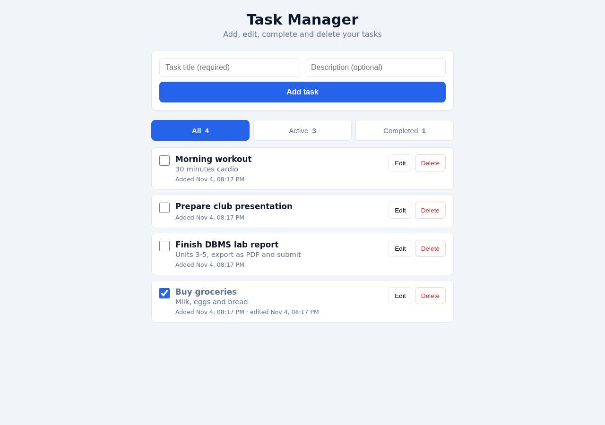
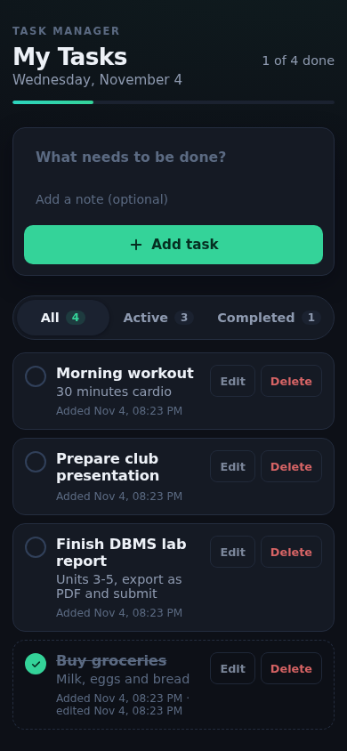
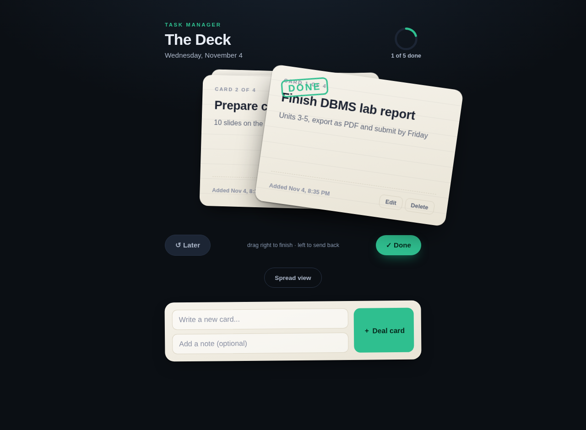
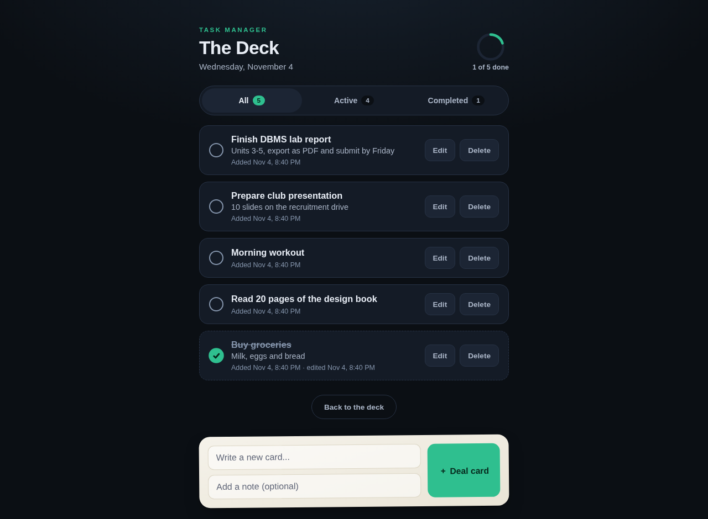

# The Deck - Task Manager

A full-stack task list application built around a physical metaphor: your tasks are a
deck of paper index cards on a dark desk. Instead of scanning a list to decide what to
do, you work the **top card** - finish it or send it to the back - one decision at a
time. A full management view (the spread) sits one tap away.

Backed by a REST CRUD API and a real SQLite database.

## Features

- **The deck** - active tasks as a stack of index cards; the top card is your focus
- **Drag the top card**: fling right to complete it, left to send it to the back of the
  deck - with real spring physics (the card tracks your pointer 1:1, keeps your throw's
  velocity, and stamps DONE as you commit)
- **Permanent Done / Later buttons** that do exactly what the gestures do (a drag cannot
  be made with a keyboard or switch), plus Undo on every completion toast
- Create cards with a title and optional note ("deal a card")
- Edit any card's title and note inline - on the deck card or in the spread
- Delete cards (two-step confirm)
- Mark tasks complete/incomplete from the spread's check circles too
- Spread view with All / Active / Completed filters and live counts
- Progress ring in the header ("X of Y done")
- Action feedback: toast on every add, edit, complete, reopen and delete, plus error toasts
- Responsive layout for phone and laptop; honors prefers-reduced-motion
- Proper API error handling: validation errors (400), not found (404), server errors (500)

## Tech stack

- **Backend:** Node.js + Express (REST API)
- **Database:** SQLite via Node's built-in `node:sqlite` module (file `tasks.db`, created automatically)
- **Frontend:** Vanilla HTML/CSS/JavaScript served by the same server (no build step)

## Live demo

Hosted on Cloudflare Workers + D1 (the same REST API, backed by a durable SQLite-compatible database):
**https://the-deck-tasks.scrollgrave.workers.dev**

It is a public assignment demo: anyone with the link can add, edit, complete and delete its tasks.

## Setup

Requires Node.js **22.5 or newer** (for the built-in SQLite module).

```bash
npm install
npm start
```

Then open http://localhost:3000 in a browser.

The SQLite database file `tasks.db` is created automatically in the project folder on first run.

## API endpoints

Base URL: `http://localhost:3000/api/tasks`

| Method | Endpoint             | Description                        | Success | Errors          |
| ------ | -------------------- | ---------------------------------- | ------- | --------------- |
| GET    | `/`                  | List tasks (`?status=all|active|completed`) | 200 | 400 bad status  |
| POST   | `/`                  | Create a task `{title, description?}`      | 201 | 400 validation  |
| GET    | `/:id`               | Get one task                       | 200     | 400, 404        |
| PUT    | `/:id`               | Edit `title`/`description`, set `completed`, and/or set `sort_order` (deck position) | 200 | 400, 404   |
| DELETE | `/:id`               | Delete a task                      | 204     | 400, 404        |

All responses are JSON. Errors return `{ "error": "message" }`.

### Example requests

```bash
# Create a task
curl -X POST http://localhost:3000/api/tasks \
  -H "Content-Type: application/json" \
  -d '{"title": "Buy groceries", "description": "Milk, eggs, bread"}'

# Mark task 1 complete
curl -X PUT http://localhost:3000/api/tasks/1 \
  -H "Content-Type: application/json" \
  -d '{"completed": true}'

# List only active tasks
curl "http://localhost:3000/api/tasks?status=active"

# Delete task 1
curl -X DELETE http://localhost:3000/api/tasks/1
```

## Design rationale

The concept and its execution come from published design work on task interfaces,
swipe-deck patterns and interface motion - each decision below names its source.

**The concept: a deck, not a list.**
Doo (iOS) proved a card stack works as a task manager for "the one-track mind": enter
tasks as cards, handle them one at a time, swipe to complete or snooze
(<https://www.macstories.net/reviews/doo-review-a-different-take-on-the-task-manager-genre/>).
The Deck adopts that focus model and fixes its two known weak points using the
swipe-deck pattern's own usability notes
(<https://vocab.design/swipe-deck>):

- **Visible buttons for every gesture, permanently** - a drag cannot be performed with a
  keyboard, switch or voice, so Done and Later sit under the deck at all times and do
  exactly what the two drag directions do.
- **Undo for fast decisions** - deck decisions are quick and cheap, so every completion
  toast carries an Undo that deals the card back to the front.
- **Send-to-back keeps the card in the deck** (MacStories' reviewer criticised Doo for
  removing snoozed cards from the stack; here a "later" card rotates to the back and its
  position is persisted in the database via `sort_order`).

**The motion: real springs, direct manipulation.**
From Karl Koch's "10 Principles for Fluid UI"
(<https://karlkoch.me/writing/10-principles-for-fluid-ui/>):

- The card tracks the pointer 1:1 while dragged (principle 3, direct manipulation).
- Release velocity is preserved into the fling-off animation instead of restarting from
  zero (principle 4); a slow drag past the threshold and a fast flick both complete, and
  feel different.
- Snap-back uses a stiffness/damping spring (300/22, inside Koch's recommended ranges)
  rather than a fixed-duration ease, and every animation is interruptible (principles 1-2).
- Under-cards settle with an overshoot spring curve when the stack changes
  (principle 7, helped users follow layout changes).
- `prefers-reduced-motion` replaces all of it with instant state changes (principle 10).

**The surface: paper on a dark desk.**
The palette keeps the restraint praised in Things 3 - near-monochrome chrome, one
emerald accent reserved for completion and the primary action, red only for destructive
steps (<https://blakecrosley.com/guides/design/things>,
<https://www.tapsmart.com/features/the-classic-app-things/>) - while the warm paper card
with ruled lines makes the deck metaphor literal and keeps ink-on-paper contrast high
(WCAG AA on every text/background pair).

## Deployment (Cloudflare Workers + D1)

The app also ships a Workers port in `worker/` (same REST contract as `server.js`, D1 instead of the local SQLite file).

```bash
npm install
npx wrangler d1 create task-manager-db   # paste the returned database_id into wrangler.toml
npx wrangler d1 execute task-manager-db --remote --file=worker/schema.sql
npx wrangler deploy
```

`wrangler.toml` keeps a placeholder `database_id` on purpose: replace it with the id from your own `wrangler d1 create`.

## Project structure

```
task-manager/
├── server.js            # Entry point: Express setup, static files, error handler
├── src/
│   ├── db.js            # SQLite database layer (table creation + queries)
│   ├── validate.js      # Shared input validation
│   └── routes/
│       └── tasks.js     # REST CRUD routes
├── public/              # Frontend (served statically)
│   ├── index.html
│   ├── styles.css
│   └── app.js
├── screenshots/         # UI and API screenshots
├── package.json
└── README.md
```

## Screenshots

| The deck (desktop) | The deck (mobile) |
| ------- | ------ |
|  |  |

| Dragging a card to done | Spread (management) view |
| ------- | ------ |
|  |  |

- [Add-card validation error state](screenshots/error-state.png)

API examples:

- [Write operations: create (201), update (200), invalid type (400)](screenshots/api-create.png)
- [List active tasks (200)](screenshots/api-list.png)
- [Error handling: validation, not found, malformed JSON (400/404)](screenshots/api-errors.png)

### Interaction refinement

Done and Later update the local deck immediately and save in parallel with a 230ms exit.
The next card moves forward without a follow-up list fetch. Writes are locked per task;
rapid double clicks cannot submit the same card twice. A saving indicator distinguishes
pending changes from confirmed saves. Failed writes restore the card, show an error,
and reconcile with the server. Undo failures are caught and reported. Drag and snap-back
transforms no longer compete with a CSS transition. Reduced motion skips the exit.
Desktop arrow keys also operate the deck when focus is outside a form or button.

The compact responsive layout keeps the paper-card deck and separates the composer
from the active card. API routes and the SQLite/D1 schema are unchanged.

### Workspace and gesture refinement

The focus/spread switch sits in a shared toolbar with the active-card count, so it
stays in the same place in both views. The composer has its own labelled section.
Laptop layouts adjust vertically on shorter displays; mobile retains full-width
controls. During a horizontal drag, the underlying cards move forward in proportion
to the drag distance and settle back on cancellation. The view switch crossfades
when the browser supports View Transitions, with an immediate fallback and reduced-
motion support. Saves and card handoff keep the same non-blocking path.
